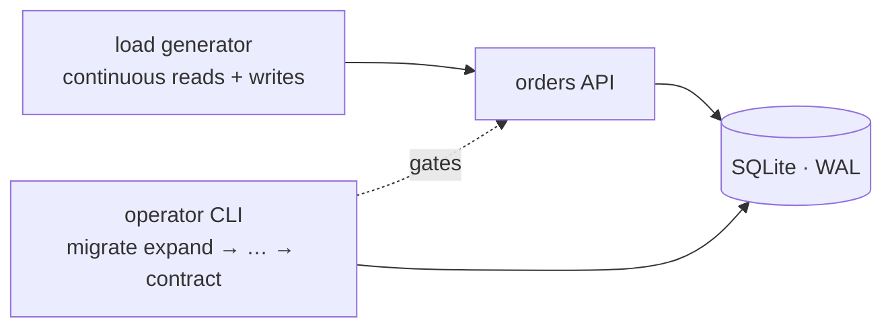

# Zero-downtime database migration

Migrating a live database schema without taking the service down — expand-contract,
resumable backfill, dual-write, verified cutover — demonstrated end-to-end with real
live traffic and a hard 0% error assertion.

```
MIGRATION RESULT: SUCCESS

Zero-downtime assertion holds: 0 failed requests out of 19,735 (0.00%)
across the full expand → contract run under continuous live traffic.

| window                  | samples | p50 | p95 | p99 | max |
| overall (whole run)     | 19,735  |  2  |  3  |  7  | 44  |
| backfill phase window   |  1,712  |  2  | 16  | 28  | 44  |
| contract phase window   |    207  |  2  | 28  | 35  | 35  |
```

An orders API keeps serving reads **and** writes while an operator migrates its
denormalized customer columns (`orders.customer_name`, `orders.customer_email`)
into a normalized `customers` table — additive DDL, dual-write, a throttled
backfill over 25k rows, an invariant-verified cutover, and finally `DROP COLUMN`.
The destructive step is the latency peak (p95 28 ms) and causes **zero errors**:
the lock becomes a wait, never a failure.

## Why this is the hard version

The naive migration is `ALTER TABLE` in a maintenance window. This repo does it
the way production systems have to: every step is individually safe and
reversible until the last one, the last one is guarded by machine-checked
invariants, and a load generator watches the whole thing ready to call it a
failure the moment a single request breaks.



| Phase | What happens | Why it's safe |
|---|---|---|
| 1. expand | add `customers` table + nullable `orders.customer_id` | purely additive |
| 2. dual-write | app writes both shapes in one txn | unmapped rows can only shrink from here |
| 3. backfill | batched, throttled, **crash-resumable** mapping of 25k historical rows | idempotent; rerun resumes from the data itself |
| 4. verify | 5 invariants (no unmapped, no orphans, mapping intact, no dupes, no garbage) | machine gate — CLI refuses cutover without a pass |
| 5. switch reads | reads JOIN `customers` | fully reversible: legacy columns still maintained |
| 6. stop legacy writes | app stops filling old columns | reversible up to contract |
| 7. contract | `DROP COLUMN` | point of no return — guarded by verify + mode gates |

## Quickstart

Requires Node ≥ 22.13 (uses the built-in `node:sqlite`). **Zero npm dependencies.**

```bash
npm install            # no-op: no dependencies, just confirms it
npm test               # 17 tests: backfill, API modes, verify gates, loadgen honesty, e2e
npm run demo           # full migration under live traffic → SUCCESS + docs/demo-report.md
npm run demo:chaos     # same, but SIGKILLs the backfill mid-run to prove resume
```

The demo seeds 25,000 dirty orders (mixed-case emails, whitespace padding),
starts the API + load generator, then walks every phase via the same operator
CLI the runbook uses, and writes `docs/demo-report.md` with the timeline,
per-phase latency, and the zero-error assertion.

Manual, step by step (the runbook):

```bash
npm run seed && npm run server          # legacy API on :3100
npm run migrate -- expand
npm run migrate -- enable-dual
npm run migrate -- backfill
npm run migrate -- verify               # gate — must pass
npm run migrate -- switch-reads
npm run migrate -- stop-legacy-writes
npm run migrate -- contract --yes       # point of no return
```

Every step has rollback (see the runbook) except the last. Out-of-order steps
are refused by gates in the CLI, not by operator discipline.

## Things this project does that are easy to get wrong

- **Atomic mode selection.** The API picks its read/write path from DB flags
  *inside the same transaction as the data access* — an operator flip or DDL
  from another process can never interleave with an in-flight request.
- **Dual-write before backfill.** Ordering invariant: after dual-write is on,
  unmapped rows monotonically decrease — no race between backfill and live writes.
- **Crash-safe backfill.** `customer_id IS NULL` is the cursor; kill it anywhere
  and rerun. Proven live by the chaos run (`SIGKILL` → resume → 0 duplicates).
- **Poison-row policy.** Legacy garbage (NULL/empty/malformed emails) is skipped
  and reported, never silently "repaired" into a customer with email `"null"`
  that merges strangers. Verify then fails on purpose and holds the gates.
- **Hard cutover gates.** `switch-reads` needs a passing verify; `contract`
  needs verify + `write_mode=new` + explicit `--yes`; `stop-legacy-writes`
  refuses if legacy columns are still `NOT NULL` (this exact bug 500'd the
  first rehearsal — see the post-mortem).
- **Honest success metric.** SUCCESS means every phase exited 0 AND the load
  generator saw literally zero failed requests. Server-side counters are
  cross-checked against the client's count.

## Documentation

- [Engineering design doc](docs/edd.md) — the decisions, invariants, failure modes
- [Runbook](docs/runbook.md) — operator-grade phase table with gates and rollbacks, incl. PostgreSQL translation
- [Post-mortem](docs/postmortem.md) — timeline, real metrics, and the two bugs that never made it to production
- [Debugging notes](docs/debugging-notes.md) — every actual bug I hit while building this, in my own words
- [Demo report (normal)](docs/demo-report.md) · [Demo report (chaos)](docs/demo-report-chaos.md)

## Layout

```
src/server.js            HTTP API — per-request mode selection inside one txn
src/migrate.js           operator CLI — one gated subcommand per phase
src/lib/backfill.js      batched, throttled, idempotent, resumable backfill
src/verify.js            invariant checker — the cutover gate
src/loadgen.js           live traffic + the zero-error success assertion
scripts/demo.js          orchestrates the whole migration under fire
test/                    17 tests incl. a full e2e migration under concurrent writes
```

## Scope, honestly

SQLite was chosen so the demo runs anywhere with zero setup — the *method*
(expand-contract, dual-write, verified cutover) is database-agnostic, and the
runbook maps every step to its PostgreSQL equivalent (`CREATE INDEX
CONCURRENTLY`, `lock_timeout`, `DROP NOT NULL`, `FOR UPDATE SKIP LOCKED`).

MIT license.
