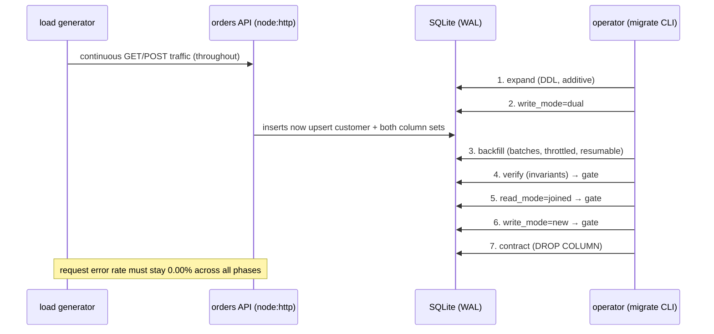

# EDD — Zero-Downtime Migration: `orders.customer_*` → normalized `customers`

**Status:** Approved · **Owner:** Aditya · **Last updated:** 2026-10-28

## 1. Context & problem

The orders service stores customer identity **denormalized** on every row of `orders`
(`customer_name`, `customer_email`). Product now needs customer-level features
(profiles, loyalty, "my orders" lookup by email). Keeping customer data denormalized
means every future customer feature requires a full-table rewrite, and the same
customer appears as N unrelated copies of a string.

We need to move to:

```sql
customers(id, name, email UNIQUE, created_at)
orders(customer_id REFERENCES customers(id), ...)   -- denormalized columns dropped
```

**Constraint: the service must stay up.** No maintenance window, no deploy freeze
window longer than a single request, no failed requests. Schema changes and data
movement happen while live traffic (reads + writes) is flowing.

## 2. Approach: expand → backfill → dual-write → verify → cutover → contract

Classic **expand-contract**. Every step is individually safe and rollback-able; the
only irreversible step (`contract`) comes last and is guarded by verification gates.

| # | Phase | Change | Downtime risk | Rollback |
|---|-------|--------|---------------|----------|
| 1 | **Expand** | `CREATE TABLE customers`; `ALTER TABLE orders ADD COLUMN customer_id INTEGER NULL` (+ index). Legacy columns become **nullable** if they weren't (Postgres: `ALTER COLUMN … DROP NOT NULL`; SQLite: baked into the baseline here because ALTER can't relax it without a rebuild) | Low — additive DDL, old code paths untouched | Drop new column/table (nothing depends on them yet) |
| 2 | **Dual-write on** | App writes legacy columns **and** `customer_id` (upsert into `customers`) in one txn | Low — write amplification only | Flip `write_mode` back to `legacy` |
| 3 | **Backfill** | Batched job maps historical rows to customers, sets `customer_id` | Low — throttled batches, no long locks | None needed — idempotent, safe to rerun |
| 4 | **Verify** | Invariant checks (see §6); must pass before cutover | None (read-only) | n/a |
| 5 | **Cut reads over** | `read_mode=joined`; reads go through `JOIN customers` | Low — legacy columns still written, so read path can flip back | `read_mode=legacy` |
| 6 | **Stop legacy writes** | `write_mode=new`; app stops populating legacy columns | Low — both schemas still valid on disk | `write_mode=dual` (rows written meanwhile have NULL legacy cols — acceptable, reads are already joined; documented in runbook) |
| 7 | **Contract** | `DROP COLUMN customer_name, customer_email` | **Point of no return** — requires steps 4–6 complete | Restore from backup (see runbook) |

### Why this order (the load-bearing invariants)

- **Dual-write starts *before* backfill.** After step 2, every *new* row gets
  `customer_id` at insert time, so the set of rows with `customer_id IS NULL` can
  only shrink from that moment on. Backfill drains it; once it hits zero it stays
  zero — no race between backfill and live writes.
- **Reads cut over only after verify passes.** Joined reads are only correct when
  every order maps to a customer row.
- **Legacy writes stop *before* DROP COLUMN.** Dropping a column the app still
  writes would 500 every write — the one real way to cause an outage here. The app
  reads its write path from the DB inside the same transaction as the insert, so a
  request can never write to a just-dropped column.

## 3. Architecture



**Components**

| Path | Role |
|------|------|
| `src/server.js` | HTTP API. Read/write path selected per-request from `app_config`, read **inside the same transaction** as the data access (snapshot isolation ⇒ no torn flag/schema reads). |
| `src/migrate.js` | Operator CLI. One subcommand per phase, each with safety gates (`backfill` refuses to run before dual-write unless `--force`; `contract` requires verify pass + `write_mode=new`). |
| `src/lib/backfill.js` | Batched, throttled, idempotent, crash-resumable backfill engine. |
| `src/verify.js` | Invariant checker; non-zero exit on failure — the gate for cutover. |
| `src/loadgen.js` | Live traffic: mixed reads/writes, latency + error tracking. The success metric for the whole exercise. |
| `scripts/demo.js` | Orchestrates a full migration under live traffic and prints the report. `--chaos` kills the backfill mid-flight to prove resume works. |

## 4. Data model decisions (the judgment calls)

1. **Customer identity = normalized email.** `lower(trim(email))`. Legacy data has
   mixed case and stray whitespace (`"  Ana@Corp.io "` vs `"ana@corp.io"`); without
   normalization these become two customers. The API normalizes at write time from
   dual-write onward; backfill normalizes historical rows.
2. **Name conflicts: first-write-wins.** `INSERT … ON CONFLICT(email) DO NOTHING`.
   If `ana@corp.io` orders twice with different name spellings, the customer keeps
   the name from the first order we saw. Rationale: silent last-write-wins rewrites
   customer identity retroactively; first-wins is stable and deterministic on
   rerun. Documented trade-off — a real system would dedupe via a review queue.
3. **Legacy columns keep raw values** (original casing/whitespace) until dropped.
   The join-verify compares `lower(trim(legacy))` to `customers.email`.
4. **`customer_id` is added NULLable.** A NOT NULL + FK add would require a table
   rebuild with default data we don't have yet — that's the lock we're avoiding.
   NULL is exactly "not yet backfilled", and the invariant "no NULLs after
   backfill" becomes the cutover gate.
5. **Poison rows are skipped, never "fixed" silently.** Legacy tables carry
   garbage: `NULL` emails, whitespace-only strings, addresses with no `@`. A
   naive backfill turns `NULL` into a customer with email `"null"` (merging
   strangers) or wedges forever on a `customers.name NOT NULL` violation.
   The backfill validates each row against the same shape the API enforces,
   leaves invalid rows unmapped, and reports them by reason. Verify then
   **fails on purpose** (`no_unmapped_orders`) and holds the cutover gates
   closed until a human fixes or excludes the data. A migration that hides
   data-quality problems is worse than one that stops for them.

## 5. Concurrency & consistency model

- **WAL mode + `busy_timeout=5000`.** Readers never block writers and vice versa;
   writers serialize and *wait* rather than error. DDL (`DROP COLUMN`) takes the
   write lock briefly — concurrent requests should see latency, never errors.
- **Atomic mode-switch reads.** The server opens `BEGIN IMMEDIATE` (writes) /
   `BEGIN DEFERRED` (reads), reads its mode flags, and performs the data access in
   the same transaction. A flag flip or DDL from the operator process cannot
   interleave with an in-flight request's decisions.
- **Idempotent backfill.** Batch = one transaction: upsert customers
   (`DO NOTHING`), then `UPDATE orders SET customer_id=? WHERE id=? AND
   customer_id IS NULL`. The scan is keyset-paginated (`id > cursor`) so a
   single run visits each row once even when rows are skipped; across runs,
   the `IS NULL` predicate is the resume point. Kill it anywhere, rerun, it
   continues. Proven by `demo --chaos` (SIGKILL mid-run).
- **Foreign keys ON.** `PRAGMA foreign_keys=ON` at every connection; the backfill
   cannot create orphans by construction, and verify re-checks it anyway.

## 6. Verification invariants (all must hold before cutover)

| Check | Query (abridged) | Expected |
|-------|------------------|----------|
| No unmapped orders | `SELECT count(*) FROM orders WHERE customer_id IS NULL` | 0 |
| No orphan FKs | orders rows whose `customer_id` has no customer | 0 |
| Email mapping intact | `lower(trim(customer_email)) = customers.email` for every joined row | 0 mismatches |
| No duplicate customers | `count(email) = count(distinct email)` on `customers` | equal (also enforced by UNIQUE) |
| Backfill idempotency | rerun backfill → 0 rows changed, 0 customers created | 0 / 0 |

## 7. Failure modes & mitigations

| Failure | Blast radius | Mitigation |
|---------|--------------|------------|
| Backfill crash mid-run | None — rows processed so far keep their `customer_id` | Rerun; `IS NULL` predicate resumes. Proven by `demo --chaos`. |
| Poison rows (NULL/empty/malformed email, NULL name) | Backfill wedges forever, or creates bogus customers that merge strangers | Rows validated + skipped with reason counts; verify fails on unmapped rows and holds the gates (§4.5) |
| Legacy columns still NOT NULL when writes stop | Every POST 500s — the one guaranteed outage | `stop-legacy-writes` refuses unless the columns are nullable; nullability is relaxed during expand (§2) |
| `SQLITE_BUSY` under contention | Latency spike | `busy_timeout` 5s; batches throttled (`sleep` between batches, lock held only per-batch) |
| Dirty emails create dup customers | Data quality | Normalize `lower(trim())` at write + backfill |
| Operator contracts too early | Outage | Hard gates in CLI: verify-pass + `write_mode=new` required; runbook marks contract as point of no return with pre-contract backup step |
| Flag flip mid-request | Torn write | Mode read + data access in one transaction (§5) |

## 8. Scope & non-goals (be honest about what this is)

- **SQLite** chosen for a zero-dependency, runs-anywhere demo (Node ≥ 22.13,
  `node:sqlite`; no npm packages at all). The *method* is database-agnostic.
- On **PostgreSQL** the same runbook maps to: `CREATE INDEX CONCURRENTLY`,
  `lock_timeout` + `statement_timeout` on every migration txn,
  `UPDATE … WHERE id BETWEEN …` in keyset batches, and batched backfill in
  `SELECT … FOR UPDATE SKIP LOCKED` workers. Differences are called out in the
  runbook where they change the operator's actions.
- Not in scope: multi-node orchestration, actual online schema-change tooling
  comparison (gh-ost/pg-rewrite), zero-downtime *app* deploys.

## 9. Success criteria

1. Full expand→contract run completes under continuous live traffic with
   **error rate 0.00%** and **zero dropped requests** (the demo's hard assertion).
2. Backfill survives a kill -9 mid-run and resumes without duplicates or loss
   (chaos run).
3. `npm test` green: unit (backfill batching/idempotency/normalization) +
   integration (API modes) + e2e (full migration under concurrent writes).
4. Post-mortem published with real timeline + latency numbers per phase.
